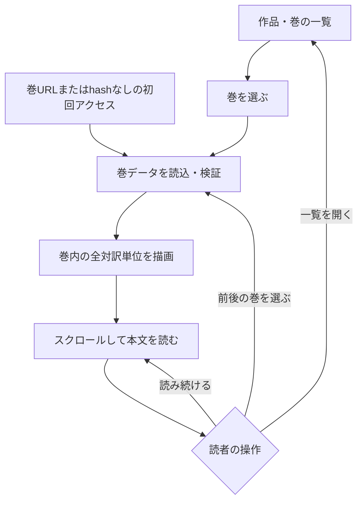
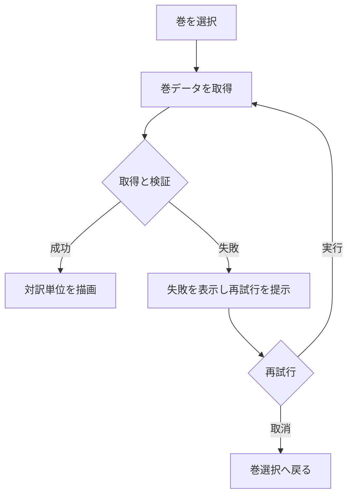
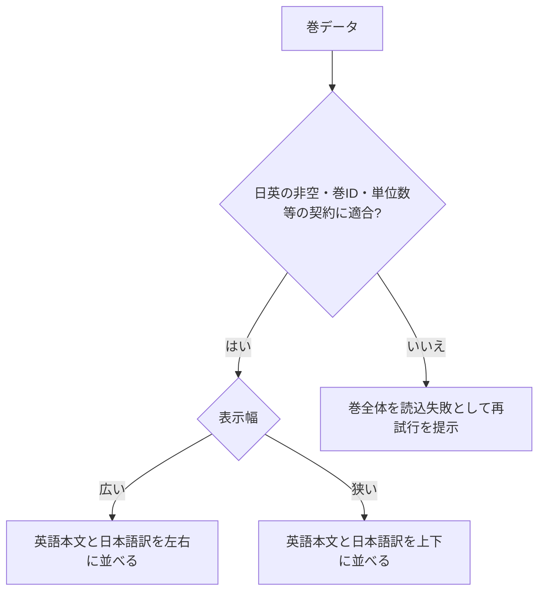
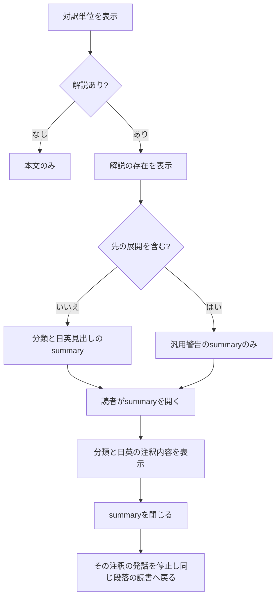
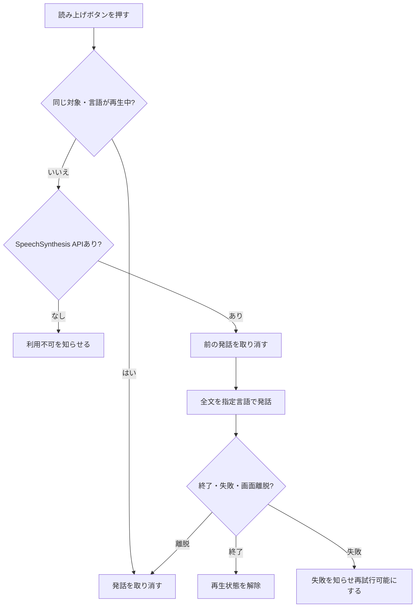
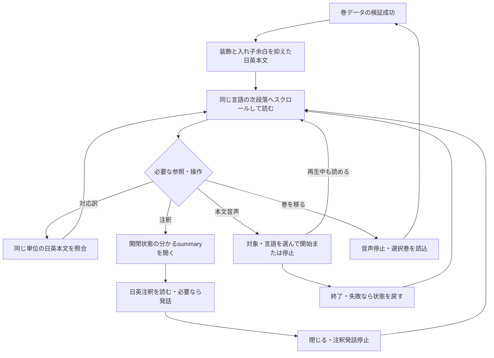
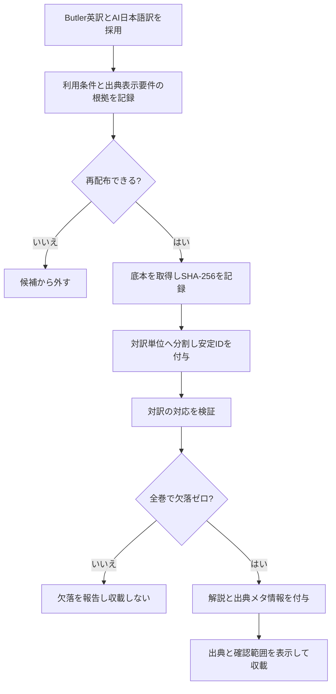
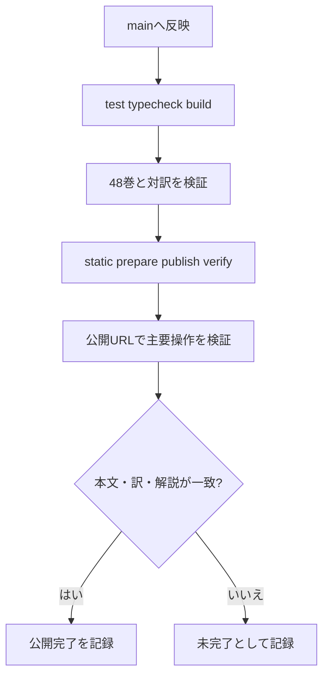
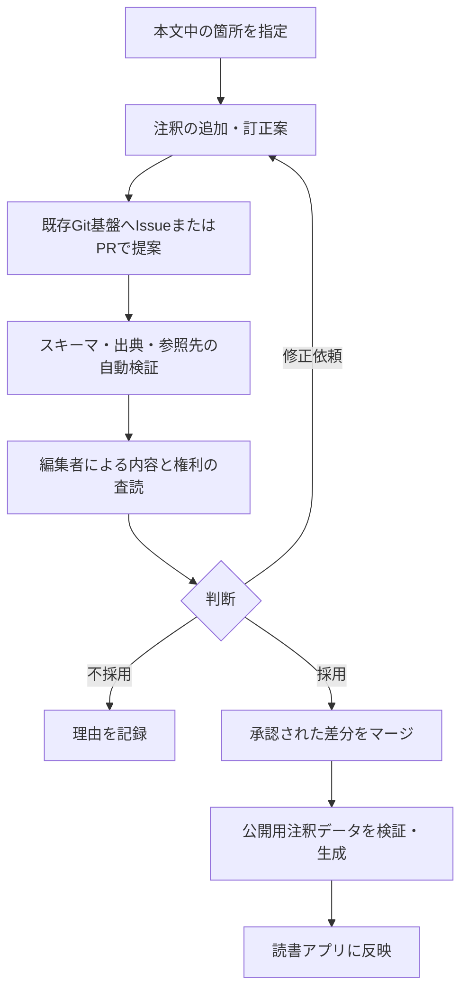

# 処理フロー

homer-readerの読書と公開の流れを示します。48巻データはmain `c149af8`に統合済みで、初回release `r1119-b3`として公開済みです。main CI #3と台帳CI #184は成功し、初回配信57ファイルのhash一致とHTTP 200を確認しました。注釈日英対応は[Gitea Issue #9](https://gitea.honya.dev/honya-dev-spa/homer-reader/issues/9)、読み上げ変更の配信・QAは[Gitea Issue #11](https://gitea.honya.dev/honya-dev-spa/homer-reader/issues/11)の完了記録を参照してください。

## 読書フロー

作品と巻を一覧で選び、巻内の全対訳単位をスクロールして読みます（R7、SPEC §6・9）。巻URLからは本文へ直接到達し、hashなしの初回アクセスは現行どおりイリアス第1巻を開きます。単位ごとのページ送りはありません。

第1巻では前巻、第24巻では次巻を無効にし、別作品へ自動遷移しません。巻読込失敗時は次節の再試行へ進みます。通常の巻移動後は巻見出しにフォーカスします。URL再読込・戻る／進むで同じ作品・巻を表示する契約（S8）は、巻内位置を保存・復元する契約を含みません。

本文は既存の「対訳」「英語」「日本語」タブで巻全体の表示を切り替えます。既定は対訳で、非表示言語の本文・注釈・音声操作へフォーカスや発話対象を残さず、切替時に非表示言語の発話を止めます（R20〜R22、T1〜T7）。B1〜B5はこの契約を維持し、新しいモード・初期値変更はQ1として保留します。

## 巻データの読込と再試行

開いた巻だけを遅延読込します。失敗時は再試行を提示し、成功するまで本文を表示済みとして扱いません（R13）。

## 対訳表示

契約を検証できた巻だけを描画し、同じ安定IDの日英本文を並べます（R8、SPEC §9）。制作途中の未対応は公開前検証で除外し、公開SPAに片側だけの仮表示は設けません。幅による並び替えは表示だけで、本文・ID・順序は変えません。

## 解説と先の展開の表示

解説は段落末尾で種別を表示し、推測は解釈として区別します。ネタバレ注釈では両言語の見出し・本文を初期表示で隠し、汎用の警告付きsummaryを読者が開いた時だけ表示します（R9、R10、R11、R15）。警告後に別の確認ダイアログは挟みません。

分類が「解釈」以外であることは、内容の事実性を保証しません。出所と校閲範囲はCONTENTと出典情報を参照します。

## 音声読み上げ

本文の英語・日本語段落、または開いた注釈の言語別表示から、ブラウザー標準APIへ表示文字列全体を渡します。再生中のボタンで停止し、別の対象を開始した場合は前の発話を取り消します。画面遷移・アプリ破棄・ページ離脱でも停止します。端末・ブラウザーで音声を利用できない場合も、読書と注釈の操作は続けられます（R16）。

## 音声サンプルの比較

サイト内入口または`#/voices`から比較画面を開き、共通原稿を使った日本語・英語の固定サンプルをnative audio controlsで試聴します。自動再生せず、別サンプルの開始・画面遷移・離脱で再生を止めます。manifestとファイルの整合は`python3 scripts/validate-audio-samples.py`で検査します。Issue #13の公開後検証は同Issueの完了記録を参照してください。

現行の「読書へ戻る」リンクは作品・巻の一覧（`#/`）へ戻ります。直前の巻・対訳単位を復元する契約はありません。名称修正と位置復帰はSPECのQ2で比較し、採用前に復帰済みの流れとして描きません。

## 改善後の読書フロー（B1〜B5実装反映済み）

R29の設計とR30の実装承認に基づくB1〜B5は、既存3タブ（対訳・英語・日本語）・インライン注釈・言語別音声操作を保ち、本文の連続性と補助情報から戻る経路を明確にします。Q1〜Q4の未採用操作はこの主フローに含めません。受入はE1〜E7へ対応します。

注釈の開閉は作品・巻URLと本文内容を変えず、ページ全体を再描画しません。注釈を閉じた後は同じ段落を見失わずに読書へ戻れることをE3で確認します。本文・注釈の発話状態変更も読書位置を強制移動させず、エラー時は文字で知らせて読書を続けられることをE4で確認します。これらは画面内の連続性であり、再訪時の保存を約束するものではありません。

### 未採用案を採用する場合の分岐

各候補はSPEC §18.3を正本とし、採用時に下記の分岐とC1〜C4を同時に確定します。Q1の既存3タブは現行操作です。ここで扱う新しいモード・初期値変更とQ2〜Q4の操作は未採用です。

| 候補 | 採用する場合に必要な流れ | 失敗・境界 |
| :--- | :--- | :--- |
| Q1 新しい表示方式・初期値変更 | 本文中の単位を保持 → 表示方法を選択 → 同じ単位の本文・対応訳を参照 → 読み続ける | 変更後の初期値・言語順は未決。既存は3タブ・既定対訳。切替でID・訳の対応・注釈のspoiler状態を失わない。 |
| Q2 位置復帰 | 巻途中 → 一覧／試聴 → 採用した戻り操作 → 元の巻・単位 | 直接試聴URL、保存不可、消えたID、戻る／進む、再読込を区別。復帰できない時に成功表示せず、通常の巻選択を可能にする。名称修正だけなら位置復帰は約束しない。 |
| Q3 注釈パネル | 対象段落 → 日英注釈を開く → 閉じる → 呼出元へ戻る | 狭幅・キーボード・支援技術でも本文と注釈の対応を保つ。対象語の位置は推測で生成しない。 |
| Q4 音声操作集約 | 対象・言語を識別 → 明示的に再生 → 読書を続ける → 停止へ到達 | 本文に重ねない。対象変更・注釈閉鎖・離脱時の既存停止契約とAPI非対応時の読書継続を保つ。 |

U17/R30によりB1〜B5を実装しました。native注釈開閉の方向表示、音声操作の対象識別、タブ切替と補足UIの修正を反映し、既存の連続表示を維持しています。検証の成功範囲と未確認はACCEPTANCE末尾へ記録します。過去の設計限定は当時の記録で、本文・注釈・音声データ不変、Q案保留、push・PR・公開の当時の禁止はU18/R31で解除されています。

## コンテンツ整備

本文の出所・利用条件の確認根拠は`CONTENT.md`に記録済みです。原文ハッシュと抽出・除外方針をmanifestで追跡します。サンプル確認は完了しましたが、全文の人手校閲ではありません（SPEC.md 11）。

## 公開

公開はGitea/Woodpecker CI経由で、ローカルネットワーク固定URL `homer-reader.honya.dev`です（SPEC U7の意図解釈）。PR #6、#7、台帳PR #95はマージされ、main CI #3・台帳CI #184を通過して初回公開済みです。最新の配信検証と公開ページQAはIssue #3完了コメントに記録します。mainでは全48巻ゲートを常時実行し、全て成功した場合だけ静的公開します。

最新の配信と公開後QAの結果はcontrollerがIssue #3完了コメントへ記録します。未実施の検査を成功扱いしません。

U18/R31によりB1〜B5を既定CI経路へ反映・公開する工程へ進みます。Q1〜Q4は今回の公開範囲に含めず、別Issueの未統合仕様を採用しません。公開結果は[Issue #21の最新記録](https://gitea.honya.dev/honya-dev-spa/homer-reader/issues/21)へ記録し、未実施を成功扱いしません。

## Issue #25の読書・詳細参照（実装反映済み）

巻URLを開く→巻情報と初期閉の版・出典details→既存3タブ→本文。言語説明は共通表示、段落は短番号と完全参照のaccessible headingで識別します。各段落の音声・注釈は既存の明示操作で利用し、停止・対象・エラーを必要時に確認できます。読書開始位置から版detailsを開く→閉じる→同じ巻・モードの本文を読む流れをH4で検証します。永続位置復帰、新URL、共通playerは追加しません。受入はH1〜H5、実装ゲートは成功し、48表示条件・native詳細往復・AT-SPI・独立レビューの結果と限界はACCEPTANCEへ記録しています。公開結果はIssue #25の最新記録へ追跡します。

## 将来構想：注釈の提案・査読・公開（未実装）

[古典注釈プラットフォーム構想](docs/annotation-platform-concept.md)の検討用フロー。**現在の`homer-reader`で利用できる操作ではない。** 採用する場合は要求・設計・受入条件を別途確定する。

本文への参照と注釈の改訂を分離し、事実の訂正と学術的異説の追加を区別する。データ形式、権限、編集ガバナンス、配信方式は未決定とする。
