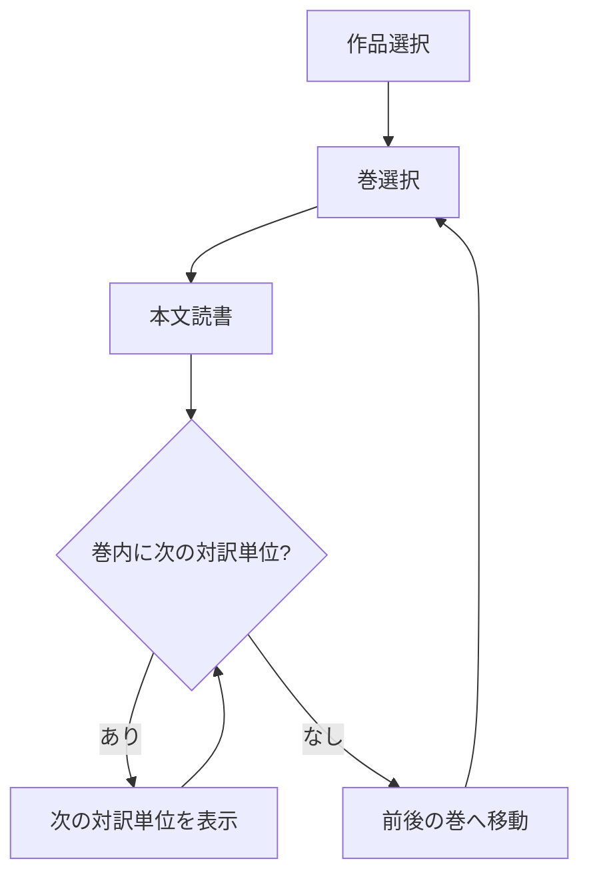
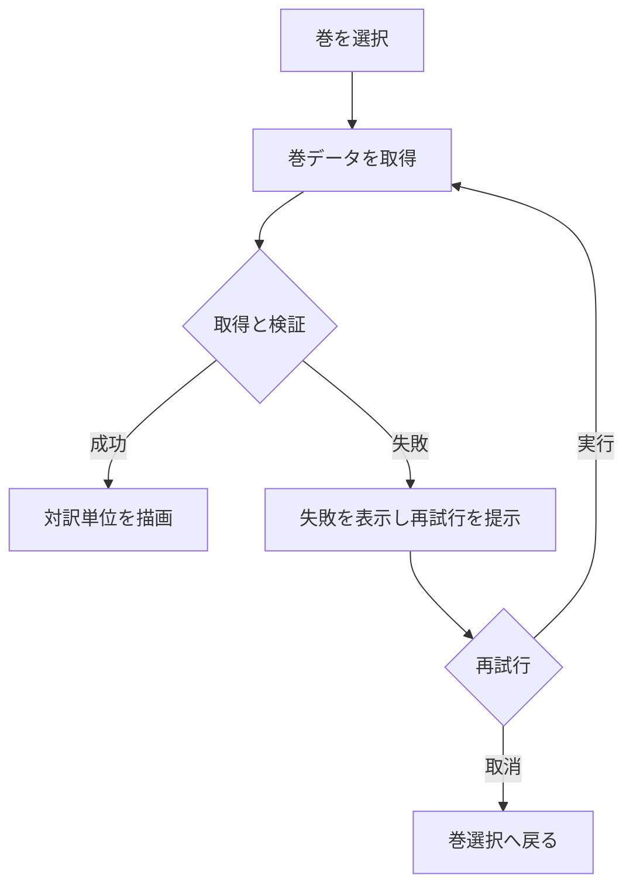
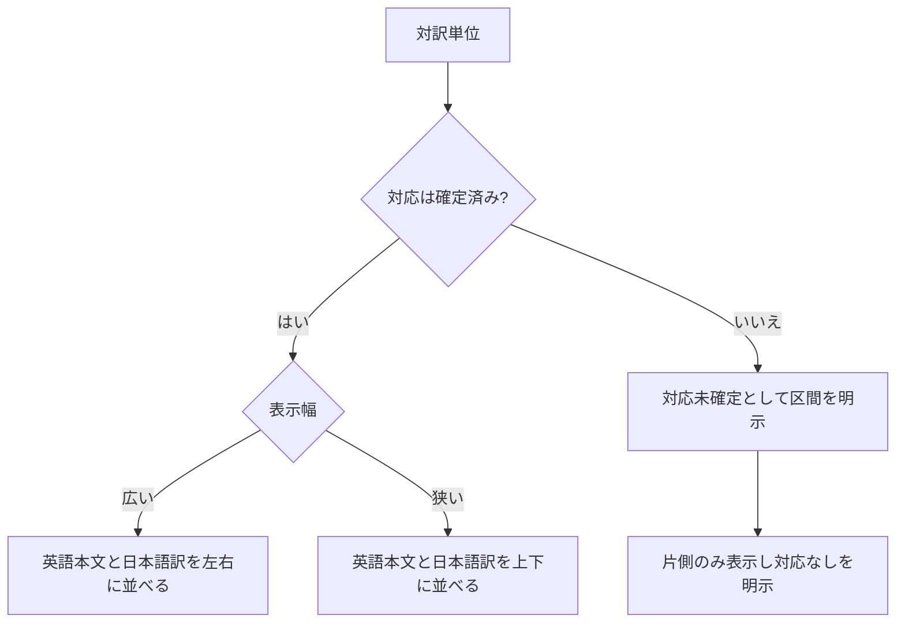
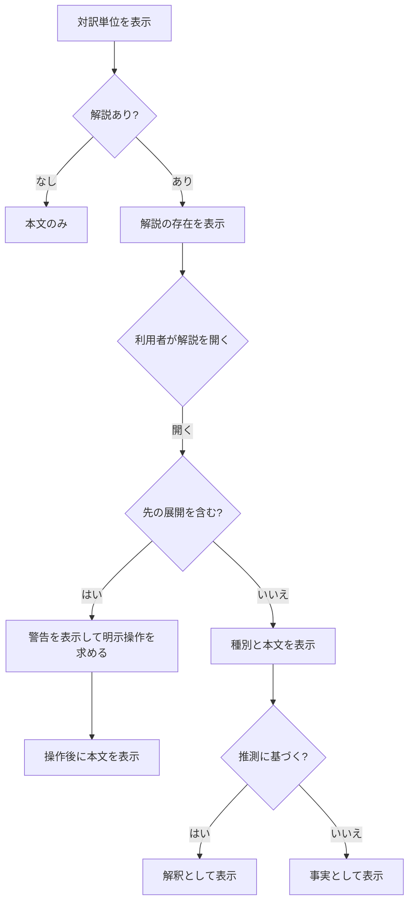
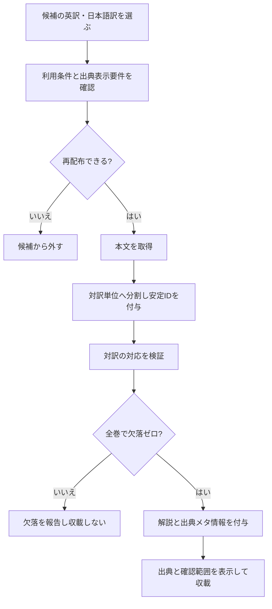
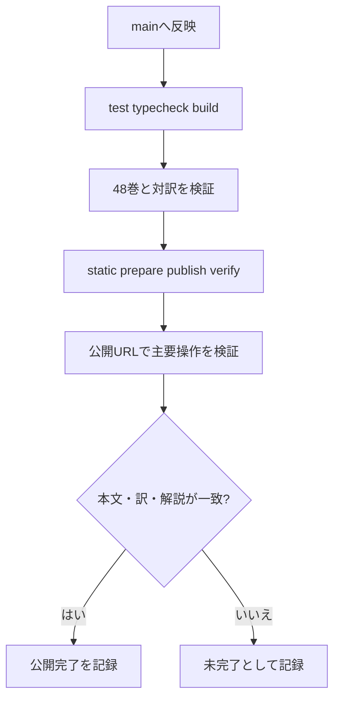

# 処理フロー

homer-readerの読書と公開の流れを示します。Issue #3のreader UIとCI設定は実装済みですが、48巻データとの統合、mainでのCI実行と公開は未完了です。

## 読書フロー

作品、巻、本文の3段階を最小操作とします（R7）。

## 巻データの読込と再試行

開いた巻だけを遅延読込します。失敗時は再試行を提示し、成功するまで本文を表示済みとして扱いません（R13）。

## 対訳表示

同じ対訳単位の英語本文と日本語訳を並べます。制作途中の対応が取れない区間は対応済みとして表示せず、完成判定では未対応を0件にします（R8、SPEC.md 9）。

## 解説と先の展開の表示

解説は種別を表示し、推測は解釈として区別します。先の展開は初期表示で隠し、明示操作で表示します（R9、R10、R11）。

## コンテンツ整備

本文を公開する前に、出所と利用条件を確認します。確認できない本文を収載しません（SPEC.md 11）。

## 公開

公開はCI経由とします（A4）。PRではtest・typecheck・build・設定確認を行い、main push/manualではこれらに全48巻のcontent gateを加え、全て成功した場合だけ静的公開します。台帳PR #95は未マージとのcontroller報告があり、公開自体は未実施です。

mainのCIと実公開はcontrollerによる統合後に行います。公開完了前に未実施の検査を成功扱いしません。
