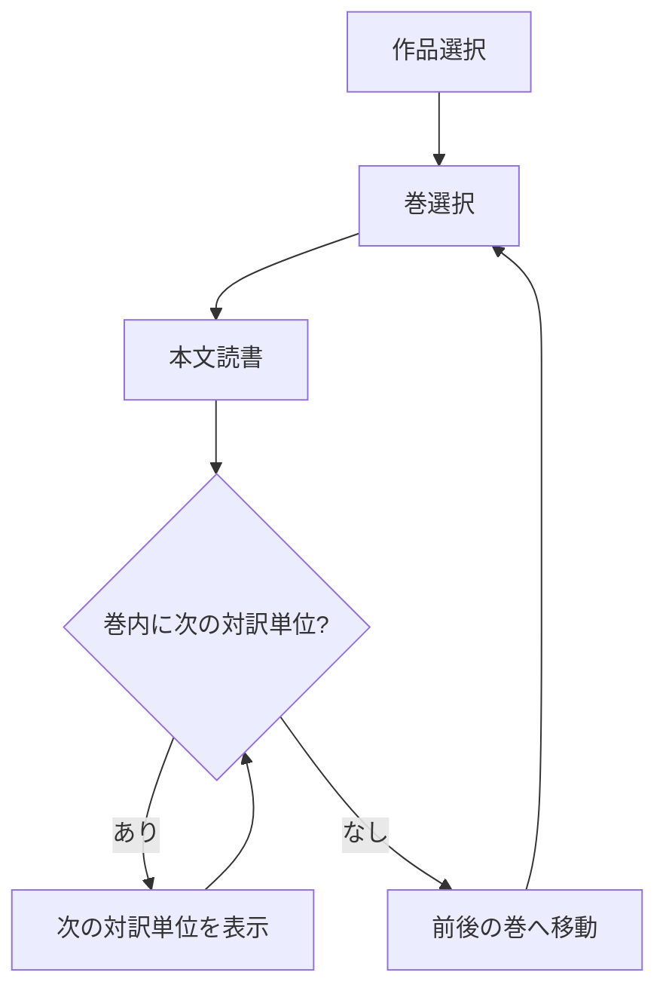
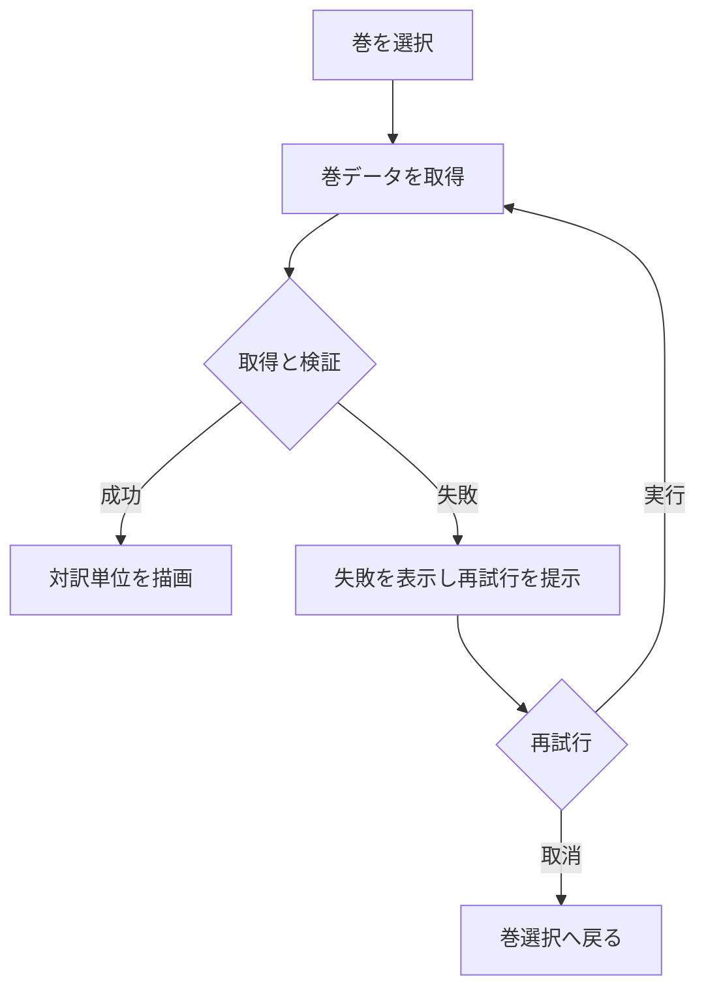
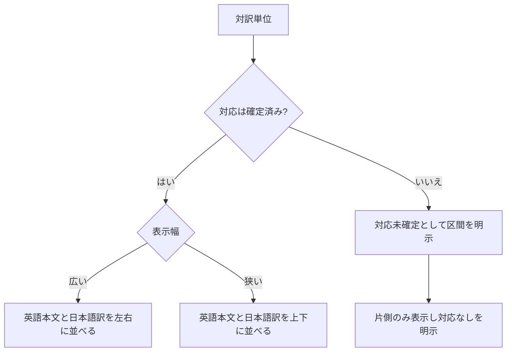
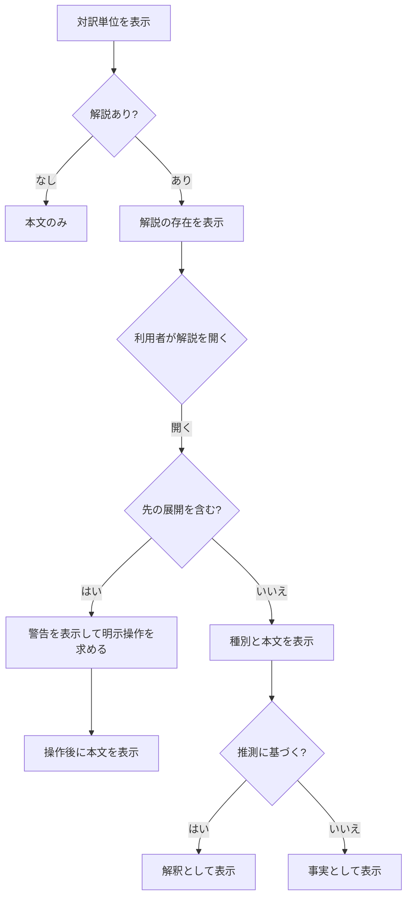
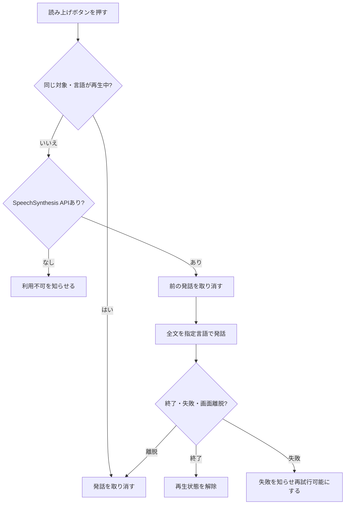
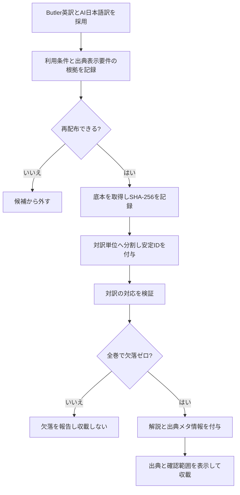
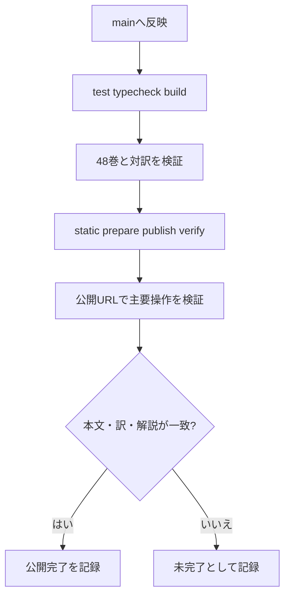

# 処理フロー

homer-readerの読書と公開の流れを示します。48巻データはmain `c149af8`に統合済みで、初回release `r1119-b3`として公開済みです。main CI #3と台帳CI #184は成功し、初回配信57ファイルのhash一致とHTTP 200を確認しました。注釈日英対応は[Gitea Issue #9](https://gitea.honya.dev/honya-dev-spa/homer-reader/issues/9)、読み上げ変更の配信・QAは[Gitea Issue #11](https://gitea.honya.dev/honya-dev-spa/homer-reader/issues/11)の完了記録を参照してください。

## 読書フロー

作品、巻、本文の3段階を最小操作とします（R7）。

本文はタブで表示方法を切り替えます。既定は日英の対訳で、英語または日本語のみの表示も選べます。選択したモードは巻全体へ適用し、段落ごとの大きなカードを使わずに読み進めます。注釈は各対訳単位に残し、必要時に開閉します。

## 巻データの読込と再試行

開いた巻だけを遅延読込します。失敗時は再試行を提示し、成功するまで本文を表示済みとして扱いません（R13）。

## 対訳表示

同じ対訳単位の英語本文と日本語訳を並べます。制作途中の対応が取れない区間は対応済みとして表示せず、完成判定では未対応を0件にします（R8、SPEC.md 9）。

## 解説と先の展開の表示

解説は種別を表示し、推測は解釈として区別します。先の展開は初期表示で隠し、明示操作で表示します（R9、R10、R11）。

## 音声読み上げ

本文の英語・日本語段落、または開いた注釈の言語別表示から、ブラウザー標準APIへ表示文字列全体を渡します。再生中のボタンで停止し、別の対象を開始した場合は前の発話を取り消します。画面遷移・アプリ破棄・ページ離脱でも停止します。端末・ブラウザーで音声を利用できない場合も、読書と注釈の操作は続けられます（R16）。

## 音声サンプルの比較

サイト内入口または`#/voices`から比較画面を開き、共通原稿を使った日本語・英語の固定サンプルをnative audio controlsで試聴します。自動再生せず、別サンプルの開始・画面遷移・離脱で再生を止めます。manifestとファイルの整合は`python3 scripts/validate-audio-samples.py`で検査します。Issue #13の公開後検証は同Issueの完了記録を参照してください。

## コンテンツ整備

本文の出所・利用条件の確認根拠は`CONTENT.md`に記録済みです。原文ハッシュと抽出・除外方針をmanifestで追跡します。サンプル確認は完了しましたが、全文の人手校閲ではありません（SPEC.md 11）。

## 公開

公開はGitea/Woodpecker CI経由で、ローカルネットワーク固定URL `homer-reader.honya.dev`です（SPEC U7の意図解釈）。PR #6、#7、台帳PR #95はマージされ、main CI #3・台帳CI #184を通過して初回公開済みです。最新の配信検証と公開ページQAはIssue #3完了コメントに記録します。mainでは全48巻ゲートを常時実行し、全て成功した場合だけ静的公開します。

最新の配信と公開後QAの結果はcontrollerがIssue #3完了コメントへ記録します。未実施の検査を成功扱いしません。
