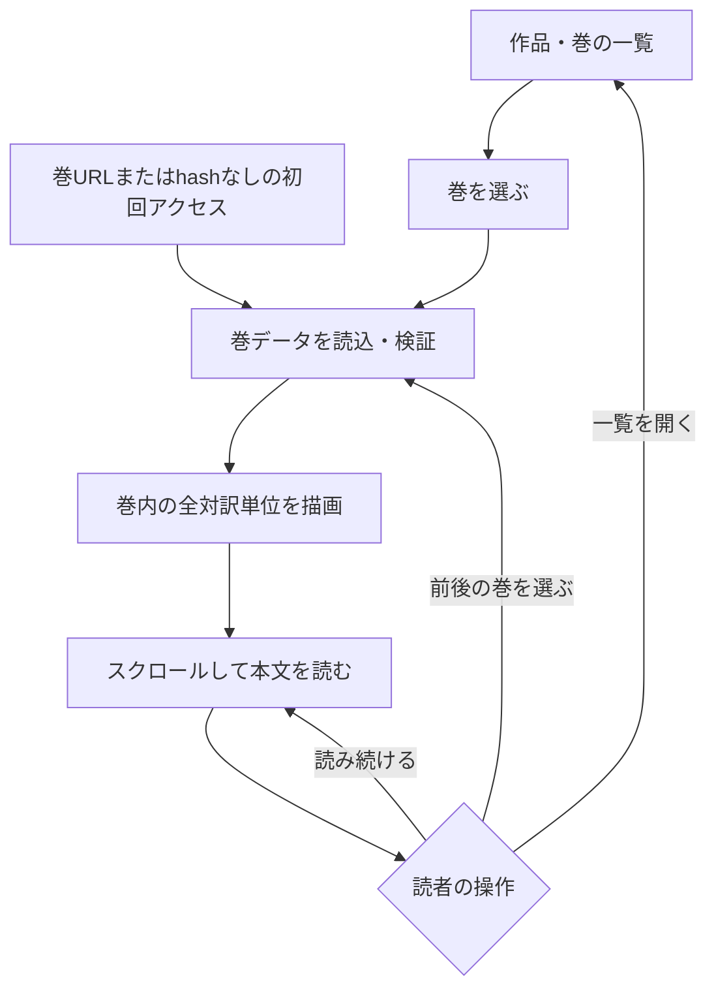
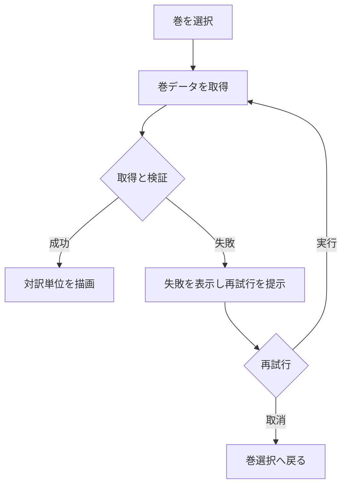
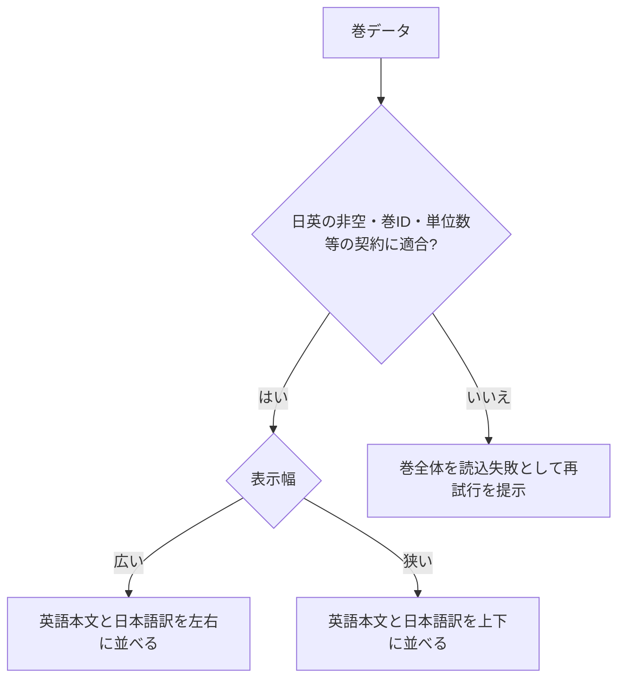
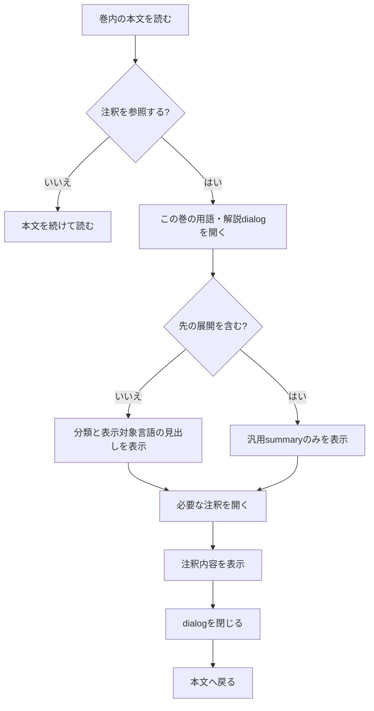
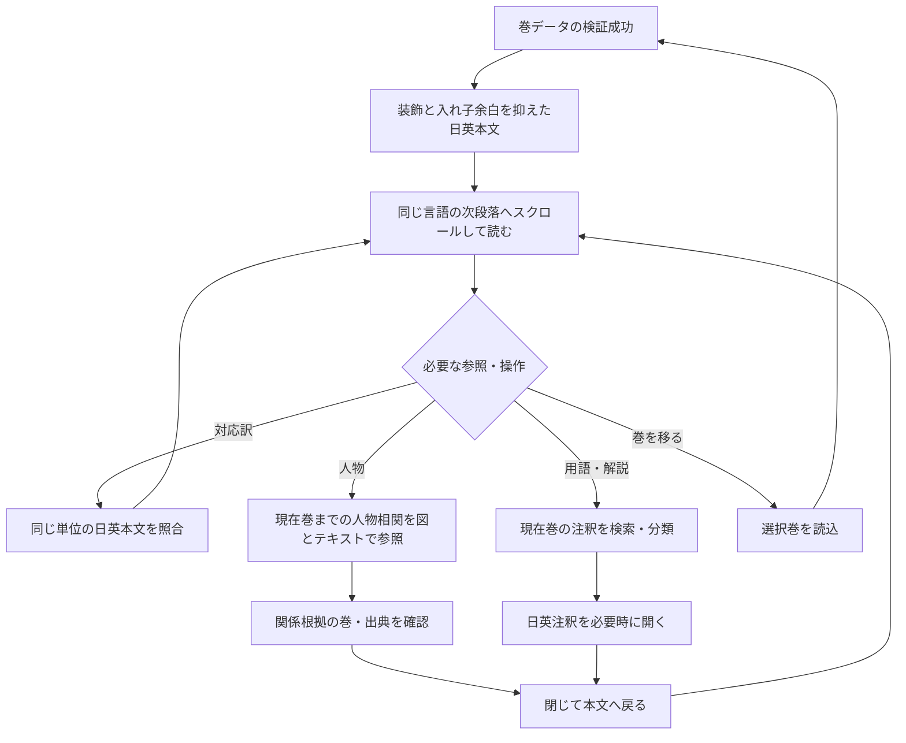
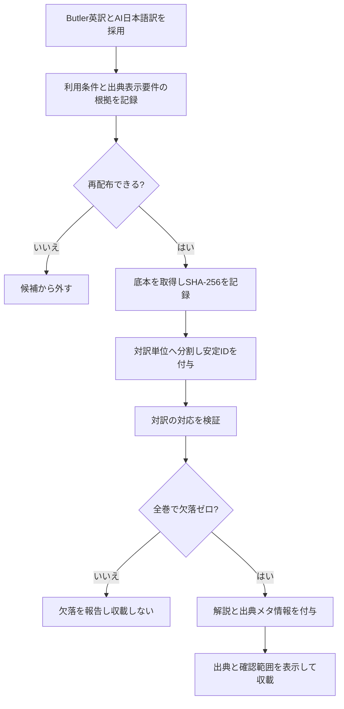
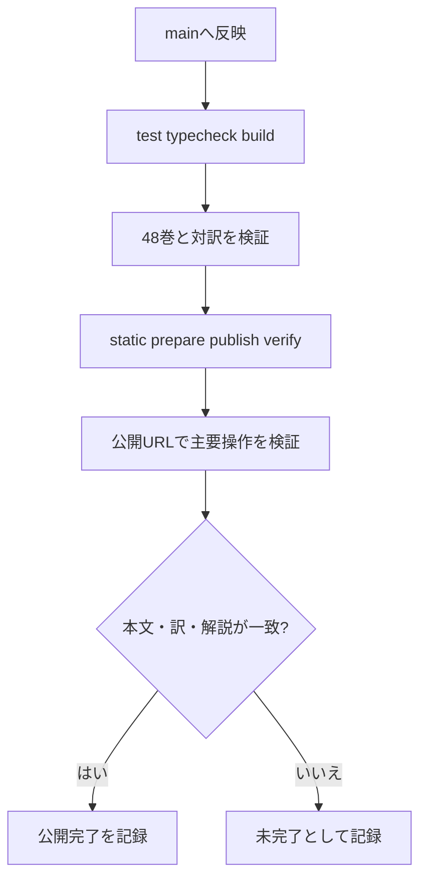
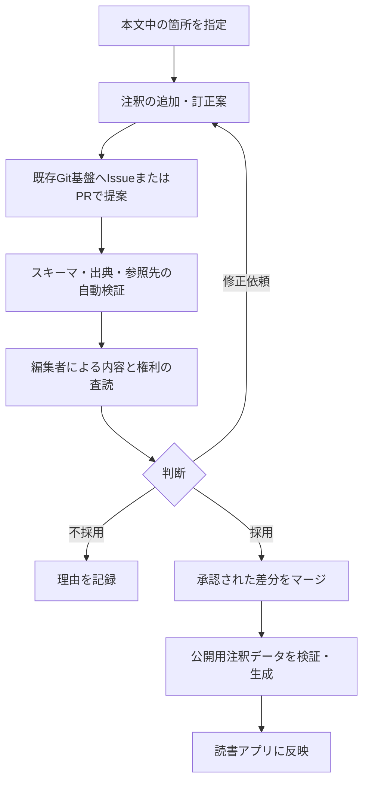

# 処理フロー

homer-readerの読書と公開の流れを示します。48巻データはmain `c149af8`に統合済みで、初回release `r1119-b3`として公開済みです。main CI #3と台帳CI #184は成功し、初回配信57ファイルのhash一致とHTTP 200を確認しました。注釈日英対応は[Gitea Issue #9](https://gitea.honya.dev/honya-dev-spa/homer-reader/issues/9)、人物相関・用語/解説パネルと読み上げUI除去は[Gitea Issue #27](https://gitea.honya.dev/honya-dev-spa/homer-reader/issues/27)の最新記録を参照してください。

## 読書フロー

作品と巻を一覧で選び、巻内の全対訳単位をスクロールして読みます（R7、SPEC §6・9）。巻URLからは本文へ直接到達し、hashなしの初回アクセスは現行どおりイリアス第1巻を開きます。単位ごとのページ送りはありません。

第1巻では前巻、第24巻では次巻を無効にし、別作品へ自動遷移しません。巻読込失敗時は次節の再試行へ進みます。通常の巻移動後は巻見出しにフォーカスします。URL再読込・戻る／進むで同じ作品・巻を表示する契約（S8）は、巻内位置を保存・復元する契約を含みません。

本文は既存の「対訳」「英語」「日本語」タブで巻全体の表示を切り替えます。既定は対訳です（R20〜R22、T1〜T7）。Issue #27で言語タブと本文・注釈データを保ったまま、読み上げ操作と音声試聴画面を現行UIから除去しました。

## 巻データの読込と再試行

開いた巻だけを遅延読込します。失敗時は再試行を提示し、成功するまで本文を表示済みとして扱いません（R13）。

## 対訳表示

契約を検証できた巻だけを描画し、同じ安定IDの日英本文を並べます（R8、SPEC §9）。制作途中の未対応は公開前検証で除外し、公開SPAに片側だけの仮表示は設けません。幅による並び替えは表示だけで、本文・ID・順序は変えません。

## 解説と先の展開の表示

段落本文は連続表示します。解説は本文上部の参照ツールバーから開く「この巻の用語・解説」dialogへまとめ、種別を示し、推測は解釈として区別します。ネタバレ注釈では両言語の見出し・本文を初期表示で隠し、汎用summaryを読者が開いた時だけ表示します（R9、R10、R11、R15、R37）。警告後に別の確認ダイアログは挟みません。

分類が「解釈」以外であることは、内容の事実性を保証しません。出所と校閲範囲はCONTENTと出典情報を参照します。

## 音声機能の履歴資産

Issue #11の読み上げ操作とIssue #13の`#/voices`比較画面は、U23/R38（Issue #27）により現行SPAから除去済みです。音声ファイル・manifest・生成スクリプト・`python3 scripts/validate-audio-samples.py`は静的配布物と品質検査用の資産として残りますが、現行UIから再生する機能はありません。

## 人物相関と用語・解説の参照

読書中は本文上部の参照ツールバーから必要なdialogを開きます。人物相関では選択中の作品・巻で根拠が確認できる人物と関係だけを示し、図と同内容のテキスト一覧を提供します。関係の向きは`from → label → to`を保ちます。用語・解説では現在巻の全注釈を集め、対訳タブでは日英、単言語タブではその言語を表示します。通常注釈は分類・見出しを示し、ネタバレ注釈は汎用ラベルだけを初期表示します。検索は開示可能な表示テキストだけを対象とし、未開示のネタバレ本文やタイトルを検索結果へ出しません。

注釈の対応段落へ移るとdialogを閉じ、読書画面の該当単位へ戻ります。人物根拠が別巻の場合は対応巻を開くリンクを示し、根拠英訳の出典URLへ辿れるようにします。Escape/閉じる操作ではdialogを呼び出したボタンへfocusを戻します。

現行の「読書へ戻る」リンクは作品・巻の一覧（`#/`）へ戻ります。直前の巻・対訳単位を復元する契約はありません。名称修正と位置復帰はSPECのQ2で比較し、採用前に復帰済みの流れとして描きません。

## 改善後の読書フロー（B1〜B5実装反映済み）

R29/R30のB1〜B5は当時の実装範囲を示す履歴です。U23/R36〜R38のIssue #27では注釈を参照panelへ集約し、人物相関・用語参照を追加し、読み上げと音声試聴UIを除去しました。G1〜G9のローカル検証と実画面QAは完了し、独立最終監査・PR CI・merge・配信の最新結果はIssue #27の完了記録を参照します。

参照dialogの開閉は作品・巻URLと本文内容を変えません。G5でspoiler検索漏れを確認し、G6でEscape/閉じる後のfocus復帰、注釈からの段落移動、URL不変を確認します。これらは画面内の復帰であり、再訪時の位置保存を約束するものではありません。

### 未採用案を採用する場合の分岐

各候補はSPEC §18.3の当時のbaseline記録です。Issue #27では人物・用語参照panelを別の要求R36〜R37で採用し、読み上げと試聴UIをR38で除去済みです。Q表は今回の現行操作を記述するものではありません。

| 候補 | 採用する場合に必要な流れ | 失敗・境界 |
| :--- | :--- | :--- |
| Q1 新しい表示方式・初期値変更 | 本文中の単位を保持 → 表示方法を選択 → 同じ単位の本文・対応訳を参照 → 読み続ける | 変更後の初期値・言語順は未決。既存は3タブ・既定対訳。切替でID・訳の対応・注釈のspoiler状態を失わない。 |
| Q2 位置復帰 | 巻途中 → 一覧／試聴 → 採用した戻り操作 → 元の巻・単位 | 直接試聴URL、保存不可、消えたID、戻る／進む、再読込を区別。復帰できない時に成功表示せず、通常の巻選択を可能にする。名称修正だけなら位置復帰は約束しない。 |
| Q3 注釈パネル（当時未採用、現在はIssue #27で別設計を採用） | 対象段落 → 現在巻の用語・解説参照panel → 閉じる/段落へ移動 | 現行の条件はIssue #27のG1〜G9。 |
| Q4 音声操作集約（Issue #27で撤回） | 旧案の履歴条件 | 現行読書UIに音声操作・試聴画面を設けない（R38）。 |

U17/R30によるB1〜B5の記録は当時の範囲です。Issue #27は本文を連続表示したまま注釈参照を集約し、人物・用語情報から本文へ戻る経路を追加済みです。検証の成功範囲と未確認はACCEPTANCEのG1〜G9およびIssue #27の最新記録を参照します。

## コンテンツ整備

本文の出所・利用条件の確認根拠は`CONTENT.md`に記録済みです。原文ハッシュと抽出・除外方針をmanifestで追跡します。サンプル確認は完了しましたが、全文の人手校閲ではありません（SPEC.md 11）。

## 公開

公開はGitea/Woodpecker CI経由で、ローカルネットワーク固定URL `homer-reader.honya.dev`です（SPEC U7の意図解釈）。PR #6、#7、台帳PR #95はマージされ、main CI #3・台帳CI #184を通過して初回公開済みです。最新の配信検証と公開ページQAはIssue #3完了コメントに記録します。mainでは全48巻ゲートを常時実行し、全て成功した場合だけ静的公開します。

初回配信と公開後QAはIssue #3完了コメントに記録済みです。後続変更の最新結果は各Issue完了記録を正本とし、未実施の検査を成功扱いしません。

U18/R31ではB1〜B5を既定CI経路へ反映・公開する工程を承認しました。後続のIssue #27では参照panel・人物相関・用語解説を追加する別要求を実装し、ローカル検証しました。最新CI・公開結果は[Issue #27の最新記録](https://gitea.honya.dev/honya-dev-spa/homer-reader/issues/27)を参照し、未実施を成功扱いしません。

## Issue #25の読書・詳細参照（実装反映済み）

巻URLを開く→巻情報と初期閉の版・出典details→既存3タブ→本文。言語説明は共通表示、段落は短番号と完全参照のaccessible headingで識別します。Issue #25の記録は当時の注釈操作を含みますが、現在は注釈をIssue #27の参照dialogへ集約します。H1〜H5の当時の検証と限界はACCEPTANCEへ記録し、現在の参照UIはG1〜G9で検証します。

## 将来構想：注釈の提案・査読・公開（未実装）

[古典注釈プラットフォーム構想](docs/annotation-platform-concept.md)の検討用フロー。**現在の`homer-reader`で利用できる操作ではない。** 採用する場合は要求・設計・受入条件を別途確定する。

本文への参照と注釈の改訂を分離し、事実の訂正と学術的異説の追加を区別する。データ形式、権限、編集ガバナンス、配信方式は未決定とする。
